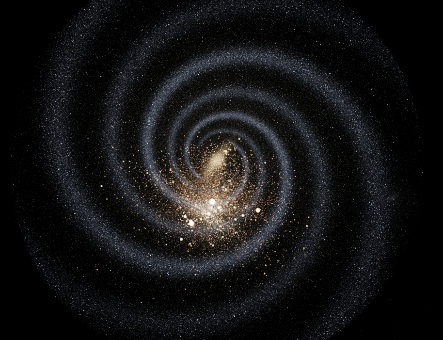
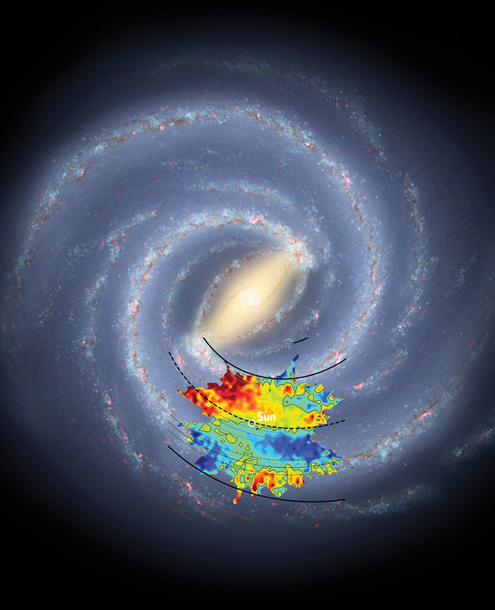
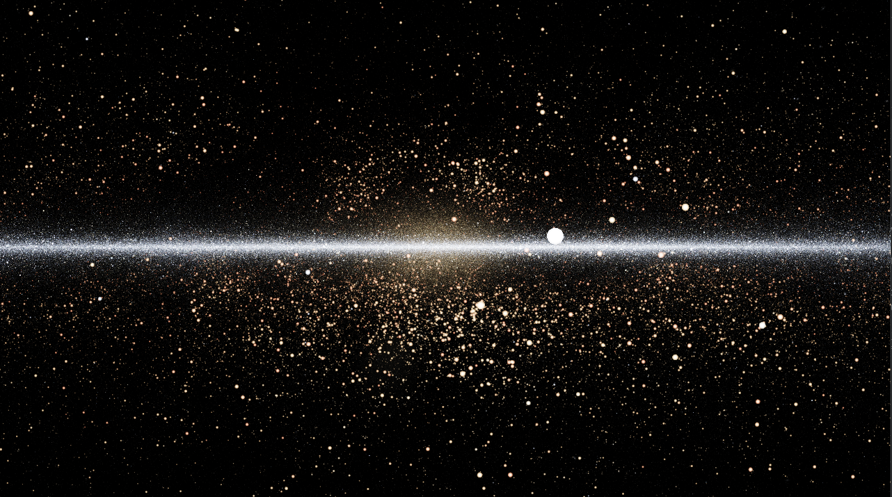
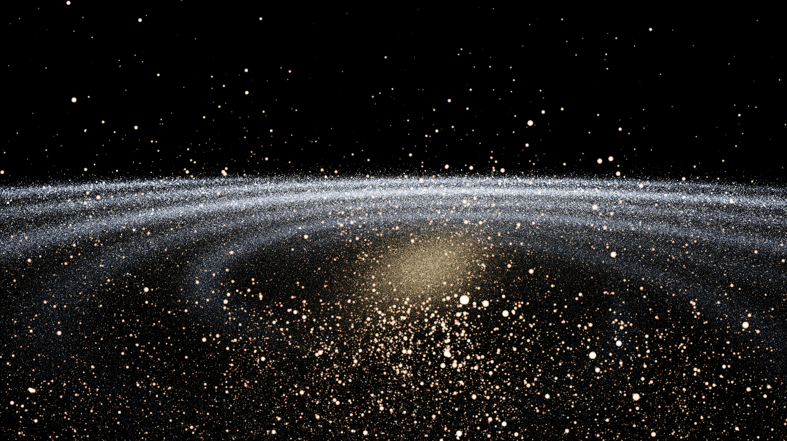
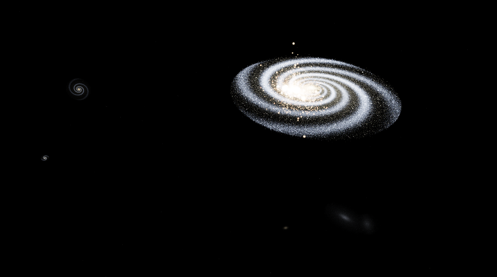
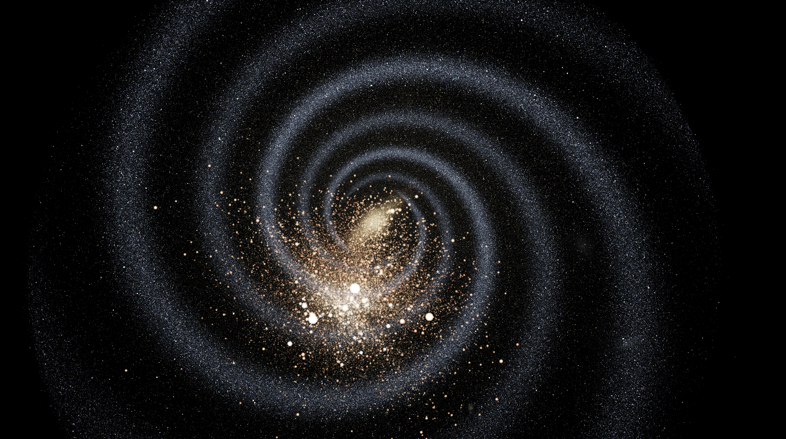
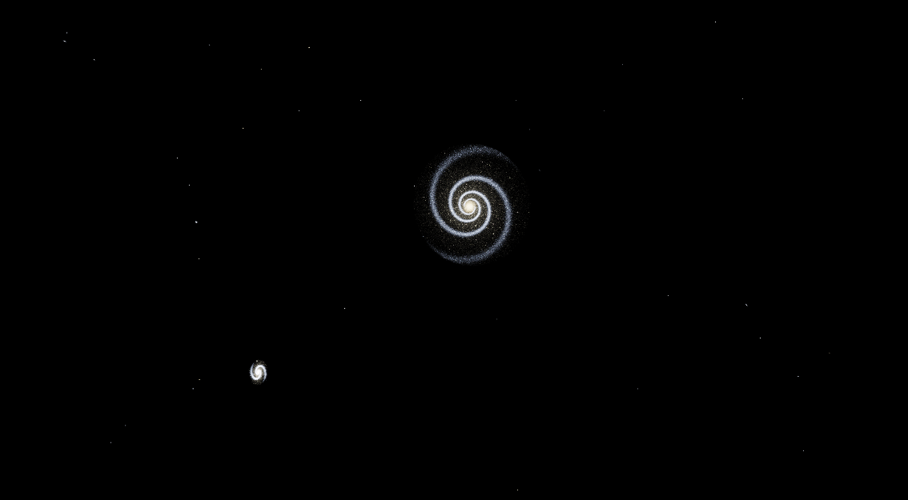
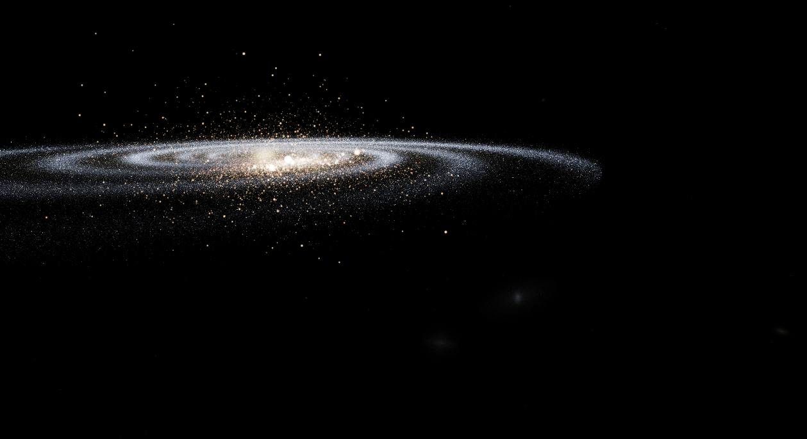

# Gaia Galaxy

A real-time 3D visualizer of the Milky Way built on real [Gaia DR3](https://www.cosmos.esa.int/web/gaia/dr3) star data. About one million stars are pulled from the Gaia archive, converted to 3D galactocentric coordinates, and rendered on the GPU with OpenGL. A procedural layer fills in the parts of the galaxy that Gaia cannot reach: a barred spiral Milky Way, its satellite and neighbor galaxies at their real positions, and hundreds of galaxies out to about 20 Mpc.


## Background: what is Gaia?

[Gaia](https://www.cosmos.esa.int/gaia) is a space observatory of the European Space Agency (ESA), launched in December 2013 and operated near the Sun-Earth L2 point, about 1.5 million km from Earth. Its goal is to build the most precise 3D map of the Milky Way: for roughly 1.8 billion stars it measured the position on the sky, the proper motion (how the star drifts across the sky), the brightness, and the color. For most of them it also measured the **parallax**.

Parallax is the tiny apparent shift of a nearby star against the distant background as Gaia moves around the Sun during the year. The smaller the shift, the farther the star. The distance in parsecs is simply `1000 / parallax` (parallax in milliarcseconds). Together with the sky coordinates (right ascension and declination), this gives every star a position in 3D, which is what this project renders.

Gaia also measures brightness in three bands: `G` (broad visible light), and the blue and red photometers `BP` and `RP`. The difference `BP - RP` is a color index that tells how hot a star is, so it is used here to color the stars, from blue-white (hot) to orange-red (cool). Combined with the distance, the apparent brightness gives the star's intrinsic (absolute) brightness.

This project uses [Data Release 3](https://www.cosmos.esa.int/web/gaia/dr3) (DR3, published in June 2022). Gaia finished its science observations in 2025, so DR3 is the data set used here. Gaia's reach is limited: reliable parallaxes extend to a few kiloparsecs, a small neighborhood around the Sun compared with the Milky Way's roughly 30 kpc diameter, and the catalog holds only a small fraction of the galaxy's stars. That is why the procedural layer described below is needed to show the galaxy as a whole.

## Comparison with the real Milky Way

Both images are shown at the same height so they line up.

<table>
  <tr>
    <th align="center">This project (procedural layer)</th>
    <th align="center">Artist's concept of the Milky Way</th>
  </tr>
  <tr>
    <td align="center"></td>
    <td align="center"></td>
  </tr>
</table>

<p align="center"><em>Tried my best to replicate.</em></p>

Right: artist's concept of the Milky Way with the Sun marked (credit: NASA/JPL-Caltech/R. Hurt, SSC/Caltech). The procedural layer is an illustrative model inspired by this structure: a central bar, two major and two minor spiral arms, and a thin disk. It is not a map of the real Milky Way.

## Video

<!-- VIDEO_PLACEHOLDER: add the demo video link here -->
*Demo video coming soon.*

A short fly-through: from the Sun through the Gaia stars, up above the disk, out to the Magellanic Clouds, Andromeda, and the galaxy groups beyond.

## Gallery

<table>
  <tr>
    <td align="center"><br><sub></sub></td>
    <td align="center"><br><sub></sub></td>
  </tr>
  <tr>
    <td align="center"><br><sub></sub></td>
    <td align="center"><br><sub></sub></td>
  </tr>
  <tr>
    <td align="center"><br><sub></sub></td>
    <td align="center"><br><sub></sub></td>
  </tr>
</table>

## Features

- ~1 million real stars from Gaia DR3, positioned in 3D from their sky coordinates and parallaxes
- Star color from the Gaia BP-RP color index, brightness from absolute magnitude and distance to the camera
- Free-fly camera with scroll-wheel speed control (from 1 pc/s up to millions of pc/s, enough to cross to other galaxies)
- Physically based star brightness: apparent magnitude `m = M + 5 log10(d) - 5`, converted to flux with a `1/d^2` falloff for Gaia stars
- HDR rendering with ACES tone mapping and a Gaussian bloom pass
- Procedural barred spiral Milky Way (central bar, two major and two minor arms, bulge, disk) for the region beyond Gaia's reach
- Neighbor galaxies at their real galactic coordinates and distances: Sagittarius dwarf, the Magellanic Clouds, six dwarf spheroidals, Andromeda (M31) and Triangulum (M33)
- 600 procedural field galaxies (spirals, ellipticals, irregulars) between 1.5 and 20 Mpc, clustered in the real M81, Sculptor, Centaurus A, Leo I, Virgo and Fornax groups
- Live stats in the window title: FPS, star counts, speed, distance from the galactic center
- Two separate parts: a Python data pipeline and a C++ / OpenGL renderer

## How it works

```
Gaia archive --(fetch_gaia.py)--> data/gaia_raw.fits
data/gaia_raw.fits --(convert_gaia.py)--> data/stars.bin
generate_galaxy.py --> data/galaxy.bin  (Milky Way + neighbors + field galaxies)
data/stars.bin + data/galaxy.bin --> C++ / OpenGL renderer
```

1. `tools/fetch_gaia.py` queries the Gaia archive with ADQL (a random sample of stars with reliable parallaxes) using `astroquery`.
2. `tools/convert_gaia.py` converts sky coordinates and distances to galactocentric Cartesian coordinates with `astropy`, computes colors and absolute magnitudes, and writes a flat binary file (7 `float32` per star: x, y, z, r, g, b, absolute magnitude).
3. `tools/generate_galaxy.py` generates the illustrative barred spiral galaxy, the neighbor galaxies and the field galaxies in the same binary format (about 8.5 million stars, ~240 MB).
4. The renderer loads both files, uploads them to the GPU as point sprites, renders into an HDR framebuffer, applies bloom, and tone maps the result to the screen. Gaia stars use the physical `1/d^2` flux falloff; the procedural layer uses a distance-independent flux so that distant galaxies stay visible.

Units are parsecs. The origin is the galactic center; the Sun is at about (-8122, 21, 0). The disk lies in the XZ plane and +Y points toward galactic north.

## Requirements

- Linux with an OpenGL 4.5 capable GPU
- A C++20 compiler, CMake 3.20+, Ninja (optional but recommended)
- GLFW, GLEW, GLM
- Python 3 with `numpy`, `astropy`, `astroquery`
- A free [Gaia archive account](https://gea.esac.esa.int/archive/) (anonymous queries are limited to 50,000 rows)

On Ubuntu / Debian:

```bash
sudo apt install build-essential cmake ninja-build git \
    libglfw3-dev libglew-dev libglm-dev mesa-utils \
    python3-venv python3-pip
```

## Setup

### 1. Python environment and data

```bash
python3 -m venv .venv
source .venv/bin/activate
pip install -r requirements.txt

mkdir -p data
python tools/fetch_gaia.py        # asks for your Gaia username and password
python tools/convert_gaia.py      # writes data/stars.bin
python tools/generate_galaxy.py   # writes data/galaxy.bin (~240 MB)
```

Tunable constants (galaxy size, number of field galaxies, brightness of the distant layers) are at the top of `tools/generate_galaxy.py`.

The fetch step can take a few minutes. The credentials are only used for the login and are never stored.

### 2. Build

```bash
cmake -S . -B build -G Ninja
cmake --build build
```

### 3. Run

Run from the repository root, because the program loads `data/` and `shaders/` by relative path:

```bash
./build/gaia_galaxy
```

On laptops with hybrid graphics, run it on the dedicated NVIDIA GPU with:

```bash
__NV_PRIME_RENDER_OFFLOAD=1 __GLX_VENDOR_LIBRARY_NAME=nvidia ./build/gaia_galaxy
```

## Controls

| Input | Action |
|---|---|
| `W` `A` `S` `D` | Move forward / left / backward / right |
| Mouse | Look around |
| Scroll wheel | Increase / decrease camera speed (multiplicative) |
| `Up` / `Down` | Brightness reference (`refMag`): lighter / darker stars |
| `Right` / `Left` | Exposure up / down |
| `Esc` | Quit |

Tips:

- To see the Milky Way as a whole, fly up out of the disk and look down.
- To visit neighbors, raise the speed with the scroll wheel. The Large Magellanic Cloud is about 50 kpc away, Andromeda 780 kpc, and the Virgo cluster about 16 Mpc toward galactic north.
- The window title shows the distance from the galactic center, so you can tell where you are.

## Project structure

```
gaia-galaxy/
├── CMakeLists.txt
├── requirements.txt
├── tools/                 # Python data pipeline
│   ├── fetch_gaia.py
│   ├── convert_gaia.py
│   └── generate_galaxy.py
├── src/                   # C++ renderer
│   ├── main.cpp
│   ├── camera.{h,cpp}
│   ├── shader.{h,cpp}
│   ├── renderer.{h,cpp}
│   ├── framebuffer.{h,cpp}
│   └── star_loader.{h,cpp}
├── shaders/               # GLSL
│   ├── stars.vert / stars.frag
│   ├── fullscreen.vert
│   ├── bright.frag / blur.frag
│   └── composite.frag
├── docs/                  # screenshots, gallery images, reference image
│   └── gallery/
└── data/                  # generated, not tracked by git
```

## Limitations

- Distances are computed as `1 / parallax`. The selection `parallax_over_error > 5` keeps this reasonable but biases the sample toward nearby and bright stars.
- Gaia only covers a few kiloparsecs around the Sun, so the large-scale structure of the galaxy comes from the procedural layer. It is illustrative, not a map of the real Milky Way.
- Neighbor galaxies and group positions use real coordinates and distances, but their internal structure is a rough model, and the field galaxies are random. They are not a catalog of real galaxies.
- The procedural layers use a flat flux model with hand-tuned dimming, so their brightness is not physically calibrated.
- On Wayland sessions the program forces the X11 backend (XWayland) so that GLEW initializes correctly.

## Acknowledgments

This work has made use of data from the European Space Agency (ESA) mission [Gaia](https://www.cosmos.esa.int/gaia), processed by the Gaia Data Processing and Analysis Consortium ([DPAC](https://www.cosmos.esa.int/web/gaia/dpac/consortium)). The data pipeline uses [Astropy](https://www.astropy.org/) and [astroquery](https://astroquery.readthedocs.io/).

## License

See [LICENSE](LICENSE).